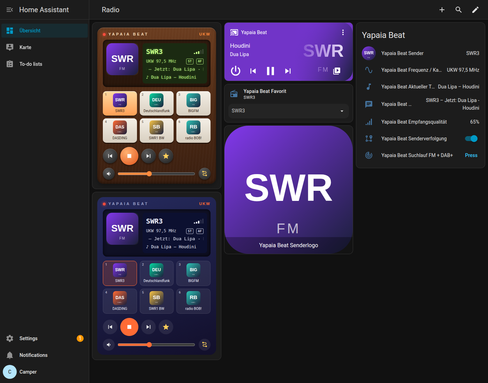
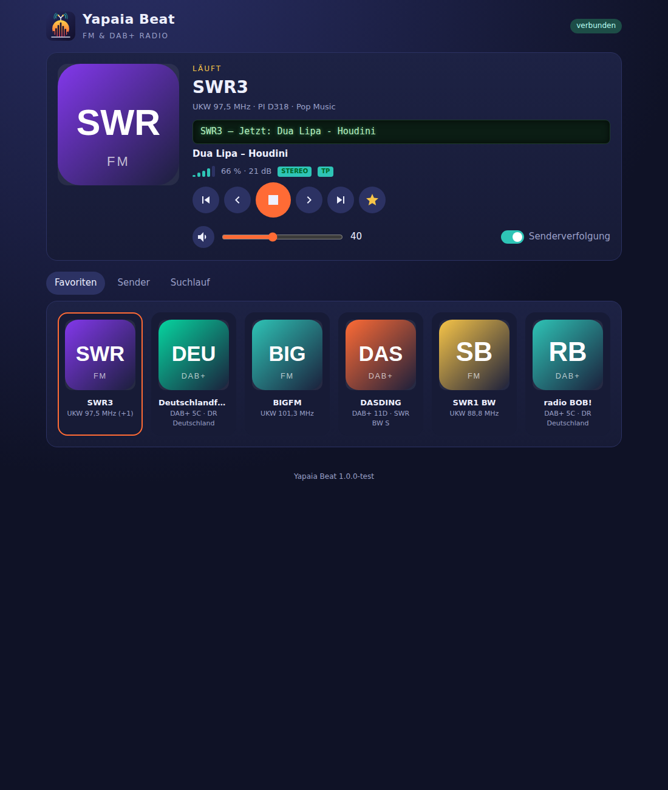
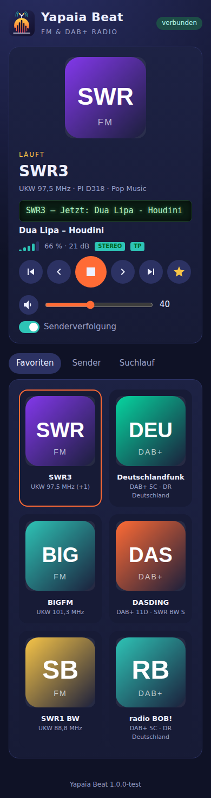

<p align="center"></p>

# Yapaia Beat – FM & DAB+ Radio für Home Assistant

Ein Home-Assistant-Add-on, das mit einem **RTL-SDR USB-Stick** UKW- und
DAB+-Radio empfängt – autark, ohne Internet, ideal für den **Camper**.

- 📻 **UKW mit RDS** (Sendername, Radiotext, RadioText+, PTY, AF, TP) und **DAB+ mit DLS & Slideshow**
- 🔎 **Automatischer Suchlauf**, **Favoriten**, Suche nach **Name oder Frequenz**
- 🖼️ **Senderlogos** (radio-browser.info mit lokalem Cache, eigene Uploads, generierte Logos)
- 🚐 **Automatische Senderverfolgung**: RDS-AF/PI-Code, andere DAB-Kanäle, Wechsel UKW ↔ DAB+
- 🔊 Wiedergabe über die **Audioausgabe von Home Assistant** und als **MP3-Stream**
- 🏠 **Integration mit Entitäten für Standard-Karten** + eigene **Radio-Karte** (Retro & Modern)

<p align="center"></p>

<p align="center">
  
  
</p>

<sub>Screenshots aus dem Simulationstest (simulierte Sender, automatisch generierte Logos).</sub>

## Installation

### Variante A – über den Add-on-Store (empfohlen, mit automatischen Updates)

[](https://my.home-assistant.io/redirect/supervisor_add_addon_repository/?repository_url=https%3A%2F%2Fgithub.com%2FYapaia%2Fyapaia)

1. Auf den Button klicken oder in Home Assistant *Einstellungen → Add-ons →
   Add-on-Store → ⋮ → Repositories* öffnen und
   `https://github.com/Yapaia/yapaia` hinzufügen.
2. **Yapaia Beat** installieren und starten.
3. Home Assistant **einmal neu starten** (das Add-on installiert dabei die
   gemeinsame Integration „Yapaia“ samt Radio-Karte).
4. *Einstellungen → Geräte & Dienste* → „Yapaia Beat“ wurde entdeckt →
   **Konfigurieren**.
5. Seitenleiste → **Yapaia Beat** → **Suchlauf**.

Updates erscheinen danach ganz normal unter *Einstellungen → Add-ons*.

### Variante B – mit dem Installationsskript

Im Add-on **„Terminal & SSH“** bzw. **„Advanced SSH & Web Terminal“**:

```bash
# installieren (trägt das Repository ein und installiert das Add-on)
curl -fsSL https://raw.githubusercontent.com/Yapaia/yapaia/main/beat/install.sh | bash

# installieren und Home Assistant danach direkt neu starten
curl -fsSL https://raw.githubusercontent.com/Yapaia/yapaia/main/beat/install.sh | bash -s -- --restart-core

# aktualisieren
curl -fsSL https://raw.githubusercontent.com/Yapaia/yapaia/main/beat/install.sh | bash -s -- --update

# deinstallieren
curl -fsSL https://raw.githubusercontent.com/Yapaia/yapaia/main/beat/install.sh | bash -s -- --uninstall
```

Weitere Optionen: `--branch NAME`, `--repo URL`, `--keep-data`.

> Das Add-on-Image wird fertig gebaut bereitgestellt
> (`ghcr.io/yapaia/yapaia-beat-<arch>`); auf dem Home-Assistant-System wird
> nichts kompiliert.

## Dokumentation

Die ausführliche Anleitung (Dashboards, Entitäten, Aktionen, Optionen,
Fehlersuche) steht in [`yapaia_beat/DOCS.md`](yapaia_beat/DOCS.md) und im
Add-on unter dem Reiter **Dokumentation**.

Schnellstart für ein Dashboard:

```yaml
type: custom:yapaia-beat-card
entity: media_player.yapaia_beat
style: retro
```

## Aufbau

```
beat/
  install.sh                    Installations-/Update-Skript
  yapaia_beat/                  das Add-on
    config.yaml, build.yaml     Add-on-Konfiguration
    Dockerfile                  baut welle-cli (DAB+) und redsea (RDS)
    rootfs/opt/yapaia/yapaia/   Radio-Dienst (Python, aiohttp)
      dsp.py                      FM-Stereo-Decoder (MPX → Audio, Signalqualität)
      fm.py / dab.py              Empfang & Suchlauf (rtl_fm/redsea/rtl_power, welle-cli)
      radio.py                    Steuerung, Favoriten, Senderverfolgung
      logos.py                    Senderlogos
      web.py                      REST-API, WebSocket, MP3-Stream
      protokoll.py                Anmeldung bei der Integration „Yapaia“
    rootfs/opt/yapaia/www/      Web-Oberfläche (Ingress)
  tests/                        Unit-Tests (pytest)
  tools/sendspin/               Bau von sendspin.js für die Radio-Karte
  art/                          Logo (SVG/PNG)
```

Der Home-Assistant-Teil (Mediaplayer, Entitäten, Radio-Karte) gehört zur
gemeinsamen Integration unter
[`integration/custom_components/yapaia/beat/`](../integration/custom_components/yapaia/beat/);
der Add-on-Store wird über [`repository.yaml`](../repository.yaml) im
Wurzelverzeichnis des Repositorys eingebunden.

## Lizenz & Credits

GPL-3.0-or-later (eigener Code von Yapaia Beat, siehe [LICENSE](LICENSE)). Verwendete Programme, Icons, Vorlagen
und ihre Lizenzen – u. a. [welle.io](https://github.com/AlbrechtL/welle.io),
[redsea](https://github.com/windytan/redsea),
[rtl-sdr](https://osmocom.org/projects/rtl-sdr) und die Google Material
Icons – sind in [CREDITS.md](CREDITS.md) aufgeführt.
