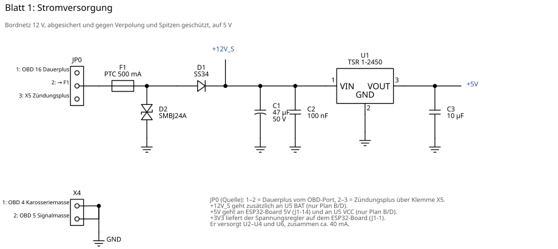
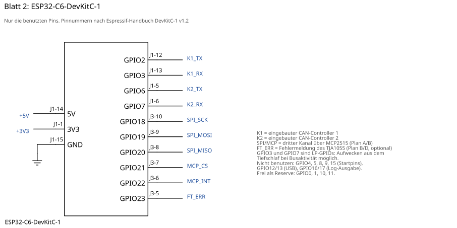
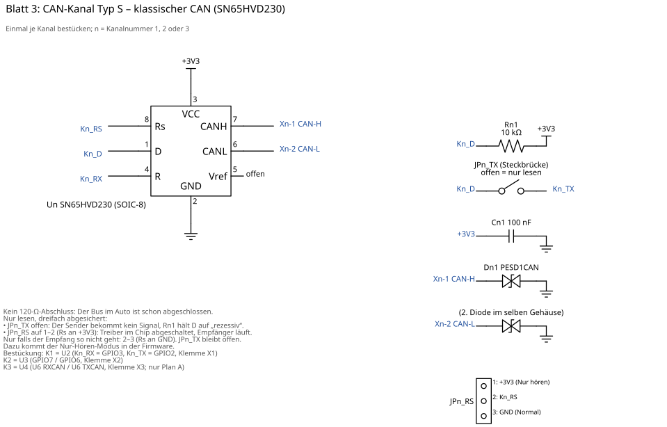
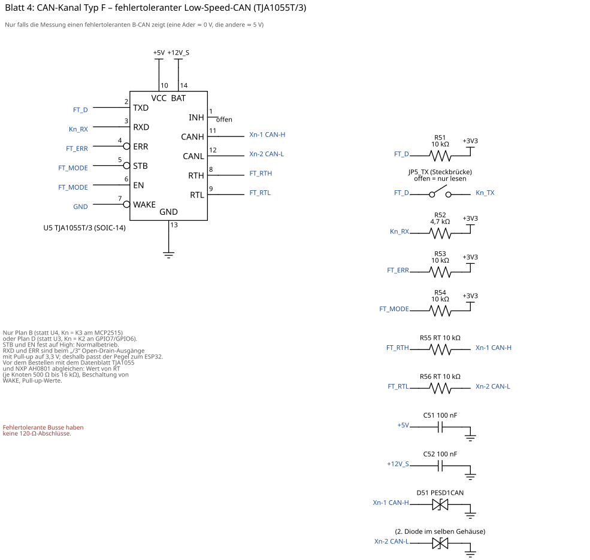
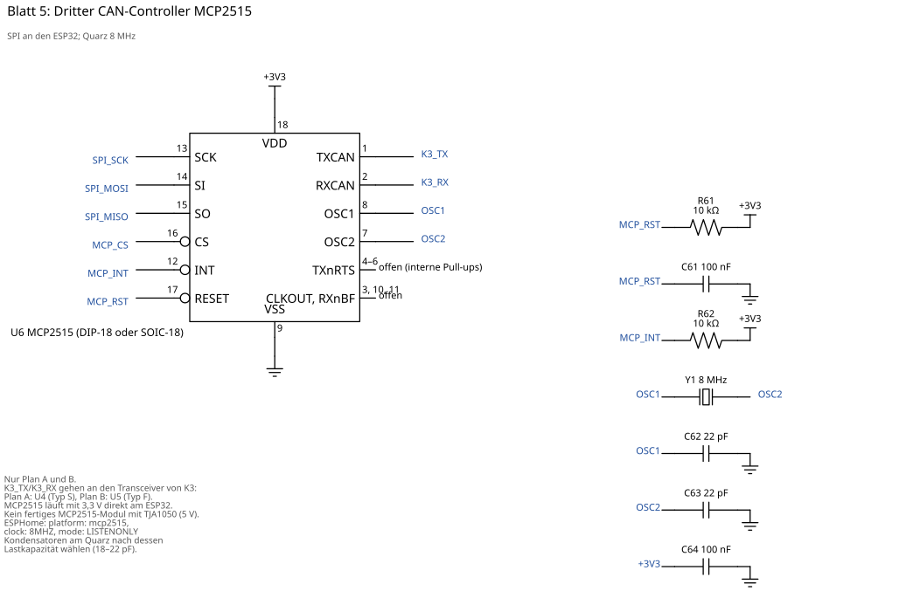
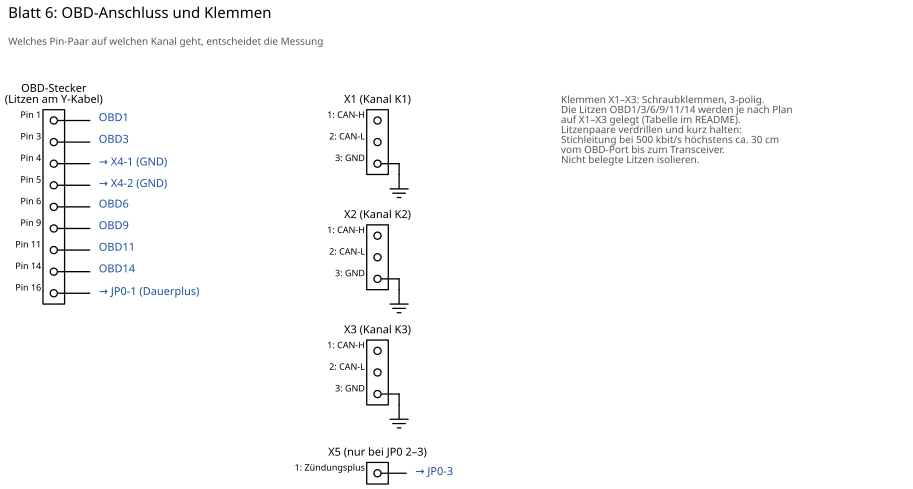

# Ducato-CAN: Hardware (Bauteileliste und Schaltplan)

**Stand: Entwurf, noch nicht aufgebaut.** Das Gerät liest bis zu drei CAN-Busse am Diagnoseport
**nur mit** und meldet die Werte per WLAN an Home Assistant. Hintergrund, Signaltabelle und
Messanleitung stehen im [README eine Ebene höher](../README.md).

Welcher Plan gebaut wird, entscheidet die Messung (Schritt 1 der Messanleitung). Die Hardware ist so
aufgeteilt, dass alle Pläne dieselbe Grundplatine nutzen. Es ändert sich nur, welche Kanäle bestückt
werden und welche OBD-Litzen auf welche Klemme kommen.

## Die vier Pläne

| Messergebnis | Plan | Kanal K1 (X1) | Kanal K2 (X2) | Kanal K3 (X3) |
|---|---|---|---|---|
| Drei klassische CAN-Paare (je beide Adern ≈ 2,5 V) | **A** | 6/14, Typ S | 3/11, Typ S | 1/9 (B-CAN), Typ S am MCP2515 |
| Wie A, aber der B-CAN ist fehlertolerant (eine Ader ≈ 0 V, die andere ≈ 5 V) | **B** | 6/14, Typ S | 3/11, Typ S | 1/9, **Typ F** am MCP2515 |
| An 3/11 liegt kein CAN (K-Lines oder unbelegt) | **C** | 6/14, Typ S | 1/9 (B-CAN), Typ S | – |
| Wie C, und der B-CAN ist fehlertolerant | **D** | 6/14, Typ S | 1/9, **Typ F** | – |

- **Typ S** = klassischer CAN mit SN65HVD230 (Blatt 3).
- **Typ F** = fehlertoleranter Low-Speed-CAN mit TJA1055T/3 (Blatt 4).
- K1 und K2 nutzen die beiden eingebauten CAN-Controller des ESP32-C6. K3 braucht den MCP2515 (Blatt 5).
- Liegt ein Bus an anderen Pins als gedacht (z. B. B-CAN an 6/14 wie beim 2009er), werden nur die
  Litzen anders auf die Klemmen gelegt. Die Platine bleibt gleich.

**Tipp:** Die Teile für alle Pläne zusammen kosten nur wenige Euro mehr. Am besten gleich alles
bestellen (Spalte „alle“ unten). Dann reicht eine Bestellung, egal was die Messung ergibt.

## Schaltplan

Gleiche **blaue Netznamen** sind miteinander verbunden. „n“ steht für die Kanalnummer (1, 2 oder 3).

| Blatt | Inhalt |
|---|---|
| [1 Stromversorgung](schaltplan/1_stromversorgung.svg) | Absicherung, Verpolschutz, Überspannungsschutz, 12 V → 5 V |
| [2 ESP32-C6](schaltplan/2_esp32.svg) | benutzte Pins des ESP32-C6-DevKitC-1 |
| [3 Kanal Typ S](schaltplan/3_kanal_typ_s.svg) | klassischer CAN, SN65HVD230 (je Kanal einmal) |
| [4 Kanal Typ F](schaltplan/4_kanal_typ_f.svg) | fehlertoleranter CAN, TJA1055T/3 (nur Plan B/D) |
| [5 MCP2515](schaltplan/5_mcp2515.svg) | dritter CAN-Controller (nur Plan A/B) |
| [6 OBD und Klemmen](schaltplan/6_obd_klemmen.svg) | OBD-Litzen, Klemmen X1–X5 |

Die Blätter werden mit [`schaltplan.py`](schaltplan.py) erzeugt (`pip install schemdraw`, dann
`python schaltplan.py schaltplan/`). Änderungen bitte dort machen, nicht in den SVG-Dateien.

### Nur lesen: dreifach abgesichert

1. **Firmware:** Alle CAN-Controller laufen im Nur-Hören-Modus (`mode: LISTENONLY`). Sie senden nicht
   einmal Empfangsbestätigungen.
2. **Steckbrücke JPn_TX offen:** Der Sendeeingang des Transceivers ist vom Controller getrennt. Ein
   Pull-up hält ihn auf „rezessiv“ (= nichts senden).
3. **Steckbrücke JPn_RS auf 1–2** (nur Typ S): Der Sendetreiber im SN65HVD230 ist abgeschaltet, nur der
   Empfänger läuft. Falls der Empfang so nicht klappt, auf 2–3 stecken. JPn_TX bleibt trotzdem offen.

JPn_TX wird nur für den Tischtest gesteckt (siehe unten), nie im Auto.

## Bauteileliste

Preise sind grobe Schätzungen (Stand Herbst 2026). Bezugsquellen z. B. Reichelt, Mouser, DigiKey, LCSC.
Die Spalten A–D nennen die Stückzahl je Plan.

### Grundplatine (alle Pläne)

| Pos. | Bauteil | Wert / Typ | Bauform | Stück | ca. € | Hinweis |
|---|---|---|---|---|---|---|
| ESP | Mikrocontroller-Board | ESP32-C6-DevKitC-1 (N8) | Board | 1 | 10 | zwei CAN-Controller, WLAN |
| U1 | Schaltregler 12 V → 5 V | Traco TSR 1-2450 | SIP-3 | 1 | 7 | Eingang 6,5–36 V, 1 A. Alternative: Pololu D36V6F5 |
| F1 | selbstrückstellende Sicherung | 500 mA Haltestrom, ≥ 30 V (z. B. Bourns MF-R050) | radial | 1 | 0,50 | |
| D1 | Schottky-Diode (Verpolschutz) | SS34 (40 V, 3 A) | SMA | 1 | 0,20 | oder 1N5819 bedrahtet |
| D2 | TVS-Diode (Spitzen) | SMBJ24A (unidirektional) | SMB | 1 | 0,40 | Kathode an +12 V; bedrahtet: P6KE27A |
| C1 | Elko | 47 µF / 50 V | radial | 1 | 0,30 | |
| C2 | Keramik | 100 nF / 50 V | RM 2,54/5,08 | 1 | 0,10 | |
| C3 | Keramik oder Elko | 10 µF / 16 V | | 1 | 0,20 | |
| JP0 | Stiftleiste + Jumper | 1×3, RM 2,54 | | 1 | 0,20 | Wahl Dauerplus/Zündungsplus |
| X4 | Schraubklemme | 2-polig, RM 5,08 | | 1 | 0,40 | Masse von OBD 4 und 5 |
| X5 | Schraubklemme | 2-polig, RM 5,08 | | 1 | 0,40 | Zündungsplus (2. Pol frei oder GND) |
| – | Buchsenleisten für das ESP-Board | 1×16 (oder passend), RM 2,54 | | 2 | 1 | ESP-Board steckbar |
| – | Lochrasterplatine | ca. 100 × 80 mm, Lötpunkte | | 1 | 3 | |
| – | Gehäuse | ca. 120 × 90 × 40 mm, Kunststoff | | 1 | 6 | WLAN-Antenne nicht abschirmen |
| – | OBD-Y-Kabel | 1 Stecker auf 2 Buchsen, **alle 16 Pins durchgeführt** | | 1 | 12 | mit Multimeter prüfen |
| – | OBD-Stecker mit Litzen | 16-polig, offene Enden | | 1 | 7 | hängt am zweiten Abgang |
| – | Litze, Schrumpfschlauch | verdrillt für CAN, 0,25–0,5 mm² | | | 5 | |

### Kanal Typ S (Blatt 3), je Kanal

| Pos. | Bauteil | Wert / Typ | Bauform | je Kanal | ca. € je Kanal | Hinweis |
|---|---|---|---|---|---|---|
| Un | CAN-Transceiver 3,3 V | SN65HVD230DR | SOIC-8 | 1 | 1,50 | U2 (K1), U3 (K2), U4 (K3) |
| – | Adapterplatine | SOIC-8 → DIP-8 | | 1 | 0,50 | |
| Rn1 | Widerstand | 10 kΩ | 0207 | 1 | 0,05 | Pull-up am Sendeeingang D |
| Cn1 | Keramik | 100 nF | | 1 | 0,10 | direkt an Pin 3/2 |
| Dn1 | CAN-Schutzdiode | PESD1CAN (2 Dioden) | SOT-23 | 1 | 0,40 | auf Adapter SOT-23 → DIP |
| – | Adapterplatine | SOT-23 → DIP | | 1 | 0,30 | |
| JPn_TX | Stiftleiste + Jumper | 1×2 | | 1 | 0,10 | **offen lassen** |
| JPn_RS | Stiftleiste + Jumper | 1×3 | | 1 | 0,15 | Standard 1–2 |
| Xn | Schraubklemme | 3-polig, RM 5,08 | | 1 | 0,50 | CAN-H, CAN-L, GND |

**Alternative:** fertiges SN65HVD230-Modul. Dann den 120-Ω-Widerstand auf dem Modul auslöten, den
TX-Anschluss über JPn_TX und einen 10-kΩ-Pull-up führen. Rs ist auf diesen Modulen meist fest an
Masse, die Wahl über JPn_RS entfällt.

### Kanal Typ F (Blatt 4), nur Plan B/D

| Pos. | Bauteil | Wert / Typ | Bauform | Stück | ca. € | Hinweis |
|---|---|---|---|---|---|---|
| U5 | fehlertoleranter CAN-Transceiver | **TJA1055T/3** (Variante für 3,3-V-Logik) | SOIC-14 | 1 | 3 | nicht die Variante ohne „/3“ |
| – | Adapterplatine | SOIC-14 → DIP-14 | | 1 | 0,50 | |
| R51, R53, R54 | Widerstand | 10 kΩ | 0207 | 3 | 0,15 | Pull-ups TXD, ERR, STB/EN |
| R52 | Widerstand | 4,7 kΩ | 0207 | 1 | 0,05 | Pull-up RXD |
| R55, R56 | Widerstand | 10 kΩ (RT, Wert prüfen) | 0207 | 2 | 0,10 | Abschluss RTH/RTL |
| C51, C52 | Keramik | 100 nF / 50 V | | 2 | 0,20 | VCC und BAT |
| D51 | CAN-Schutzdiode | PESD1CAN | SOT-23 | 1 | 0,40 | mit Adapter |
| JP5_TX | Stiftleiste + Jumper | 1×2 | | 1 | 0,10 | **offen lassen** |

Vor dem Bestellen mit dem Datenblatt TJA1055 und der NXP-Application-Note AH0801 abgleichen:
Wert von RT (je Knoten 500 Ω bis 16 kΩ; ein reiner Mithörer nimmt einen hohen Wert), Beschaltung
von WAKE (hier an GND) und die Pull-up-Werte.

### MCP2515 (Blatt 5), nur Plan A/B

| Pos. | Bauteil | Wert / Typ | Bauform | Stück | ca. € | Hinweis |
|---|---|---|---|---|---|---|
| U6 | CAN-Controller | MCP2515-I/P | DIP-18 | 1 | 2,50 | **kein** fertiges Modul mit TJA1050 |
| – | IC-Fassung | 18-polig | | 1 | 0,30 | |
| Y1 | Quarz | 8 MHz | HC-49 | 1 | 0,30 | |
| C62, C63 | Keramik | 22 pF (nach Lastkapazität des Quarzes) | | 2 | 0,10 | |
| C61, C64 | Keramik | 100 nF | | 2 | 0,10 | Reset und VDD |
| R61, R62 | Widerstand | 10 kΩ | 0207 | 2 | 0,10 | Pull-ups RESET, INT |

### Stückzahlen je Plan

| Baugruppe | A | B | C | D | alle (empfohlen) |
|---|---|---|---|---|---|
| Grundplatine | 1 | 1 | 1 | 1 | 1 |
| Kanal Typ S | 3 | 2 | 2 | 1 | 3 |
| Kanal Typ F | – | 1 | – | 1 | 1 |
| MCP2515-Block | 1 | 1 | – | – | 1 |
| **ca. Kosten** | **70 €** | **72 €** | **62 €** | **64 €** | **75 €** |

Dazu fürs Messen (einmalig): OBD-Breakout-Box (15–25 €), CANable 2.0 (25–40 €), Multimeter.
Siehe [Einkaufsliste](../README.md#einkaufsliste).

## Verdrahtungsliste

Für den Aufbau auf Lochraster: jedes Netz mit allen Anschlüssen. Pins der ICs nach Datenblatt
(Draufsicht, Kerbe oben links = Pin 1). Teile in Klammern nur, wenn der Plan sie enthält.

### Versorgung und Masse

| Netz | Anschlüsse |
|---|---|
| OBD 16 | OBD-Litze Pin 16 → JP0-1 |
| 12V_EIN | JP0-2 → F1 |
| KL15 | X5-1 → JP0-3 |
| (Knoten nach F1) | F1 → D2 Kathode → D1 Anode |
| +12V_S | D1 Kathode, C1 +, C2, U1 Pin 1, (U5 Pin 14 BAT, C52) |
| +5V | U1 Pin 3, C3, ESP J1-14 (5V), (U5 Pin 10 VCC, C51) |
| +3V3 | ESP J1-1 (3V3), alle Un Pin 3, alle Cn1, alle Rn1, alle JPn_RS-1, (U6 Pin 18, C64, R61, R62), (R51–R54) |
| GND | X4-1 (OBD 4), X4-2 (OBD 5), ESP J1-15, D2 Anode, C1 −, C2, C3, U1 Pin 2, alle Un Pin 2, alle Cn1, alle Dn1 Pin 3, alle JPn_RS-3, alle Xn-3, (U6 Pin 9, C61–C64), (U5 Pin 13 und Pin 7 WAKE, C51, C52, D51 Pin 3) |

### Kanal K1 (Typ S, U2, Klemme X1)

| Netz | Anschlüsse |
|---|---|
| K1_TX | ESP J1-12 (GPIO2) → JP1_TX-2 |
| K1_D | JP1_TX-1, U2 Pin 1 (D), R11 → +3V3 |
| K1_RX | ESP J1-13 (GPIO3), U2 Pin 4 (R) |
| K1_RS | U2 Pin 8 (Rs), JP1_RS-2 |
| X1-1 CAN-H | U2 Pin 7, D11 Pin 1 |
| X1-2 CAN-L | U2 Pin 6, D11 Pin 2 |

### Kanal K2 (Typ S mit U3, oder in Plan D Typ F mit U5; Klemme X2)

| Netz | Typ S (Plan A/B/C) | Typ F (Plan D) |
|---|---|---|
| K2_TX | ESP J1-5 (GPIO6) → JP2_TX-2 | ESP J1-5 (GPIO6) → JP5_TX-2 |
| K2_D | JP2_TX-1, U3 Pin 1, R21 → +3V3 | JP5_TX-1, U5 Pin 2 (TXD), R51 → +3V3 |
| K2_RX | ESP J1-6 (GPIO7), U3 Pin 4 | ESP J1-6 (GPIO7), U5 Pin 3 (RXD), R52 → +3V3 |
| X2-1 CAN-H | U3 Pin 7, D21 Pin 1 | U5 Pin 11, D51 Pin 1, R55 |
| X2-2 CAN-L | U3 Pin 6, D21 Pin 2 | U5 Pin 12, D51 Pin 2, R56 |
| sonst | K2_RS: U3 Pin 8, JP2_RS-2 | siehe Typ F unten |

### Kanal K3 (nur Plan A/B; Klemme X3)

| Netz | Typ S (Plan A) | Typ F (Plan B) |
|---|---|---|
| K3_TX | U6 Pin 1 (TXCAN) → JP3_TX-2 | U6 Pin 1 → JP5_TX-2 |
| K3_D | JP3_TX-1, U4 Pin 1, R31 → +3V3 | JP5_TX-1, U5 Pin 2, R51 → +3V3 |
| K3_RX | U6 Pin 2 (RXCAN), U4 Pin 4 | U6 Pin 2, U5 Pin 3, R52 → +3V3 |
| X3-1 CAN-H | U4 Pin 7, D31 Pin 1 | U5 Pin 11, D51 Pin 1, R55 |
| X3-2 CAN-L | U4 Pin 6, D31 Pin 2 | U5 Pin 12, D51 Pin 2, R56 |
| sonst | K3_RS: U4 Pin 8, JP3_RS-2 | siehe Typ F unten |

### Typ F: restliche Anschlüsse von U5

| Netz | Anschlüsse |
|---|---|
| FT_ERR | U5 Pin 4, R53 → +3V3, ESP J3-5 (GPIO23) optional |
| FT_MODE | U5 Pin 5 (STB), U5 Pin 6 (EN), R54 → +3V3 |
| FT_RTH | U5 Pin 8 → R55 → CAN-H |
| FT_RTL | U5 Pin 9 → R56 → CAN-L |
| – | U5 Pin 7 (WAKE) → GND, U5 Pin 1 (INH) offen |

### MCP2515 (nur Plan A/B)

| Netz | Anschlüsse |
|---|---|
| SPI_SCK | ESP J3-10 (GPIO18), U6 Pin 13 |
| SPI_MOSI | ESP J3-9 (GPIO19), U6 Pin 14 (SI) |
| SPI_MISO | ESP J3-8 (GPIO20), U6 Pin 15 (SO) |
| MCP_CS | ESP J3-7 (GPIO21), U6 Pin 16 |
| MCP_INT | ESP J3-6 (GPIO22), U6 Pin 12, R62 → +3V3 |
| MCP_RST | U6 Pin 17, R61 → +3V3, C61 → GND |
| OSC1 | U6 Pin 8, Y1, C62 → GND |
| OSC2 | U6 Pin 7, Y1, C63 → GND |
| offen | U6 Pin 3, 4, 5, 6, 10, 11 |

### OBD-Litzen auf die Klemmen (nach Plan)

| Plan | X1 (K1) H / L | X2 (K2) H / L | X3 (K3) H / L |
|---|---|---|---|
| A | 6 / 14 | 3 / 11 | 1 / 9 |
| B | 6 / 14 | 3 / 11 | 1 / 9 |
| C | 6 / 14 | 1 / 9 | – |
| D | 6 / 14 | 1 / 9 | – |

Welche Ader eines Paars CAN-H ist, zeigt die Messung (CAN-H geht bei Verkehr nach oben, CAN-L nach unten).
Ist es vertauscht, kommt nur Unsinn oder gar nichts an. Kaputt geht dabei nichts.

## Aufbau-Hinweise

- **Kurze Stichleitungen:** Vom OBD-Port bis zum Transceiver höchstens ca. 30 cm (bei 500 kbit/s).
  Das Gehäuse deshalb nah am Diagnoseport unterbringen und die CAN-Paare verdrillen.
- **Keine 120-Ω-Widerstände:** Die Busse im Auto sind schon abgeschlossen.
- **Abblockkondensatoren** (Cn1, C64, C51) direkt an die IC-Pins setzen.
- **Quarz** und seine Kondensatoren nah an U6, kurze Leitungen.
- **ESP-Board steckbar** auf Buchsenleisten. Die Antenne ragt über den Platinenrand hinaus, nicht über Kupfer.
- **USB und Bordnetz:** Das ESP-Board nicht gleichzeitig über USB und über 12 V versorgen, solange nicht im
  Schaltplan des DevKitC-1 geprüft ist, dass zwischen USB und dem 5-V-Pin eine Diode sitzt. Flashen am besten
  auf dem Tisch, danach per WLAN (OTA).

## Inbetriebnahme auf dem Tisch

1. **Ohne ESP-Board und ohne ICs:** Labornetzteil 12 V mit Strombegrenzung (100 mA) an JP0. 5 V an
   ESP J1-14 messen. Verpolung kurz testen: Es darf kein Strom fließen.
2. **ESP-Board stecken, ICs noch nicht:** ESPHome flashen (per USB, ohne 12 V). Danach mit 12 V: 3,3 V
   an J1-1 messen.
3. **ICs einsetzen.** Strom sollte unter ca. 120 mA bleiben (mit WLAN).
4. **Nur-lesen prüfen:** Mit allen JPn_TX offen muss an Pin 1 jedes SN65HVD230 ca. 3,3 V liegen. An
   Pin 8 liegen bei JPn_RS 1–2 ebenfalls 3,3 V.
5. **Tischtest der Kanäle:** X1 und X2 mit einem verdrillten Paar verbinden, an beiden Enden je
   120 Ω zwischen CAN-H und CAN-L. Auf beiden Kanälen JPn_TX stecken und JPn_RS auf 2–3, beide in der
   Test-Firmware auf `mode: NORMAL` (sonst bestätigt niemand die Frames). K1 sendet, K2 muss die Frames
   empfangen. Danach K2 ↔ K3 genauso testen. **Zum Schluss alle JPn_TX ziehen und alle JPn_RS
   auf 1–2.** So geht das Gerät ins Auto.

## Offene Punkte

- TJA1055T/3: Werte und WAKE-Beschaltung gegen Datenblatt/AH0801 prüfen (siehe oben); Verfügbarkeit prüfen.
- SN65HVD230 im Nur-Hören-Modus (Rs high): laut Datenblatt läuft der Empfänger weiter. Im Tischtest
  bestätigen. Falls nicht, JPn_RS auf 2–3.
- Ob drei Busse und WLAN auf dem ESP32-C6 zusammen stabil laufen, zeigt der erste Test.
