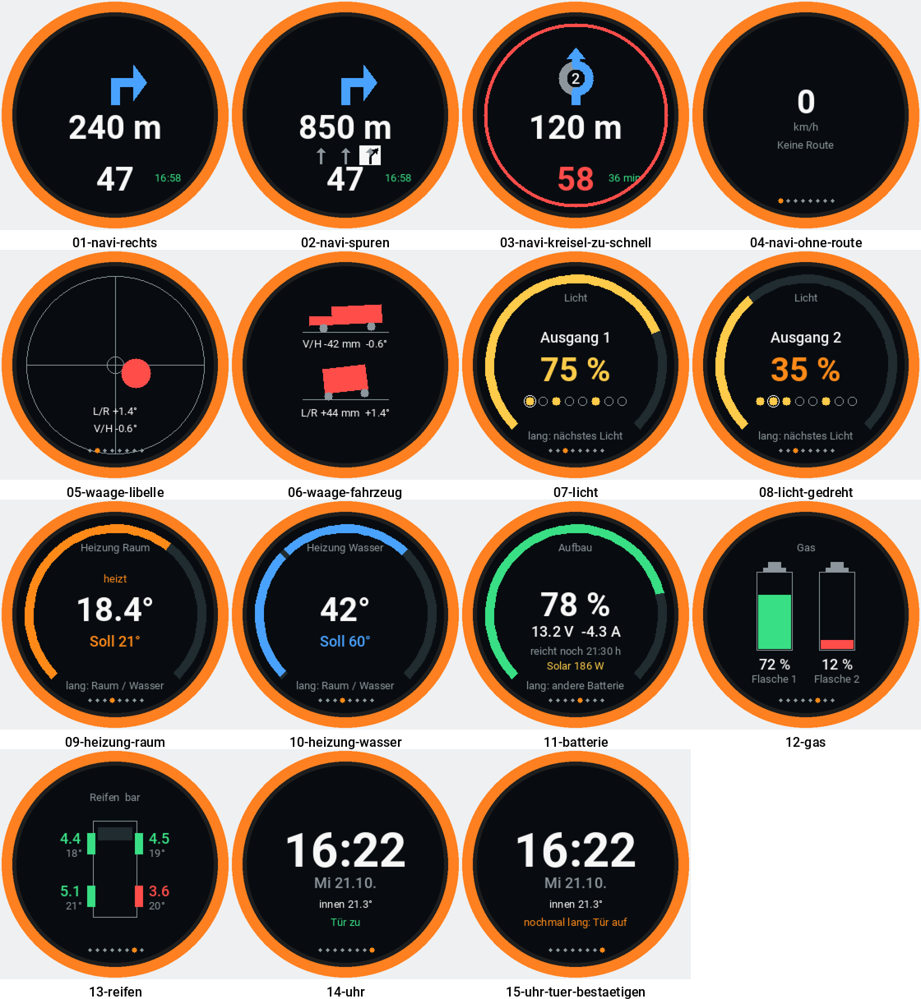

# Yapaia auf dem M5Stack Dial

`m5-dial.yaml` macht aus dem **M5Stack Dial** einen Drehknopf fürs Wohnmobil:
dieselbe Navigationsanzeige und Wasserwaage wie
[`yapaia-nav-display/`](../yapaia-nav-display/), dazu Licht, Heizung, Batterie,
Gas, Reifendruck und eine Uhr mit Türschloss.



## Das Gerät

| | |
|---|---|
| Chip | M5StampS3 (**ESP32-S3**), 8 MB Flash, kein PSRAM |
| Anzeige | 1,28″ **rund**, 240 × 240, GC9A01A an SPI |
| Eingabe | orangefarbener Drehring (Drehgeber an GPIO40/41) und ein Taster unter dem Display (GPIO42) |
| Sonst | Summer (GPIO3), Echtzeituhr PCF8563, Touch, NFC (hier nicht benutzt) |

Die Pinbelegung stammt aus der [ESPHome-Gerätesammlung](https://devices.esphome.io/devices/m5stack-dial/).

## Bedienung

| | |
|---|---|
| **kurz drücken** | nächste Ansicht |
| **drehen** | verstellen, was die Ansicht verstellen kann |
| **lang drücken** | die Auswahl in der Ansicht wechseln |

| Ansicht | drehen | lang drücken |
|---|---|---|
| Navi | rechts Restzeit, links Ankunftszeit | Restzeit ↔ Ankunft |
| Waage | rechts Fahrzeugansicht, links Libelle | Libelle ↔ Fahrzeug |
| Licht | Helligkeit, ganz links = aus | nächstes Licht |
| Heizung | Solltemperatur, unter 5° = aus (Warmwasser: Aus/40/60/80) | Raum ↔ Warmwasser |
| Batterie | – | Batterie 1 ↔ 2 |
| Gas | – | – |
| Reifen | – | – |
| Uhr | Helligkeit des Displays | Tür abschließen; **aufschließen nur mit zweitem langem Druck** innerhalb von 5 s |

Steht eine Abbiegung kurz bevor (Vorgabe: 300 m), springt die Anzeige von selbst
auf die Navigation — außer man hat in den letzten 10 Sekunden am Knopf gedreht
oder gedrückt. Der rote Ring für „zu schnell" erscheint in **jeder** Ansicht.

Unten am Rand zeigen kleine Punkte, in welcher Ansicht man ist (auf Navi und
Waage nur kurz nach dem Umschalten).

## Einrichten

1. Im ESPHome Device Builder ein neues Gerät anlegen und den Inhalt von
   `m5-dial.yaml` übernehmen.
2. In die `secrets.yaml` des Device Builders eintragen:
   ```yaml
   m5_dial__api_key: "…"   # 32 Byte base64, erzeugt der Device Builder
   ```
   (`wifi_ssid` und `wifi_password` gibt es dort schon.)
3. Per USB-C flashen, in Home Assistant übernehmen.
4. **Wichtig, sonst lässt sich nichts verstellen:** in Home Assistant unter
   *Einstellungen → Geräte & Dienste → ESPHome → Yapaia Dial → Konfigurieren*
   „Dem Gerät erlauben, Home-Assistant-Aktionen auszuführen" einschalten.
   Licht, Heizung und Tür werden über Home Assistant gestellt
   (`homeassistant.action`), nicht direkt.

## Was oben in den `substitutions:` anzupassen ist

- **`seiten`** – welche Ansichten in welcher Reihenfolge. Wer z. B. keine
  Reifendrucksensoren hat, nimmt die `6` heraus.
- **`licht1_name` … `licht8_name`** – „Ausgang 3" sagt im Dunkeln niemandem
  etwas, „Vorzelt" schon.
- **`reifen_warn_bar`** – unter diesem Druck wird ein Reifen rot.
- **Entitäten** – sie folgen den Namen der vorhandenen ESPHome-Geräte
  (`heizung`, `smartwomo`, `btcollector`, `door`). Wer ein Gerät in Home
  Assistant umbenannt hat: *Entwicklerwerkzeuge → Zustände* zeigt die echten
  Namen.
- Die Werte der **Wasserwaage** (Radstand, Spurweite, Vorzeichen) sind dieselben
  wie beim Navi-Display.

## Wenn etwas nicht stimmt

| Beobachtung | Abhilfe |
|---|---|
| Display bleibt schwarz, im Protokoll „Could not allocate buffer for display" | unter `display:` `color_palette: 8BIT` eintragen |
| Eine Rastung am Drehring springt zwei Schritte | beim `rotary_encoder` `resolution: 2` eintragen |
| Drehen in die falsche Richtung | `pin_dreh_a` und `pin_dreh_b` tauschen |
| Drehen zeigt den neuen Wert, aber das Licht ändert sich nicht | Schritt 4 oben: Aktionen in Home Assistant erlauben |
| „Nichts kommt an" auf der Navi-Ansicht | Gerät ist in Home Assistant nicht eingebunden |
| Eine Ansicht zeigt nur „--" | Entitätsname oben in den `substitutions:` prüfen |

## Vorschau ohne Gerät

`vorschau/vorschau.py` holt die Zeichenroutine aus der YAML, übersetzt sie mit
`g++` gegen eine kleine Nachbildung der ESPHome-Zeichenbefehle und malt jede
Ansicht als PNG. So fällt C++, das nicht übersetzt, schon vor dem Flashen auf.

```
python3 vorschau/vorschau.py --schriften <Ordner mit Roboto-Regular/-Medium/-Bold.ttf> --ziel vorschau/bilder
```

Braucht `g++`, Pillow und PyYAML. Die Bilder sind eine Annäherung: Schriftbreite
und Kantenglättung des echten Panels weichen etwas ab.
