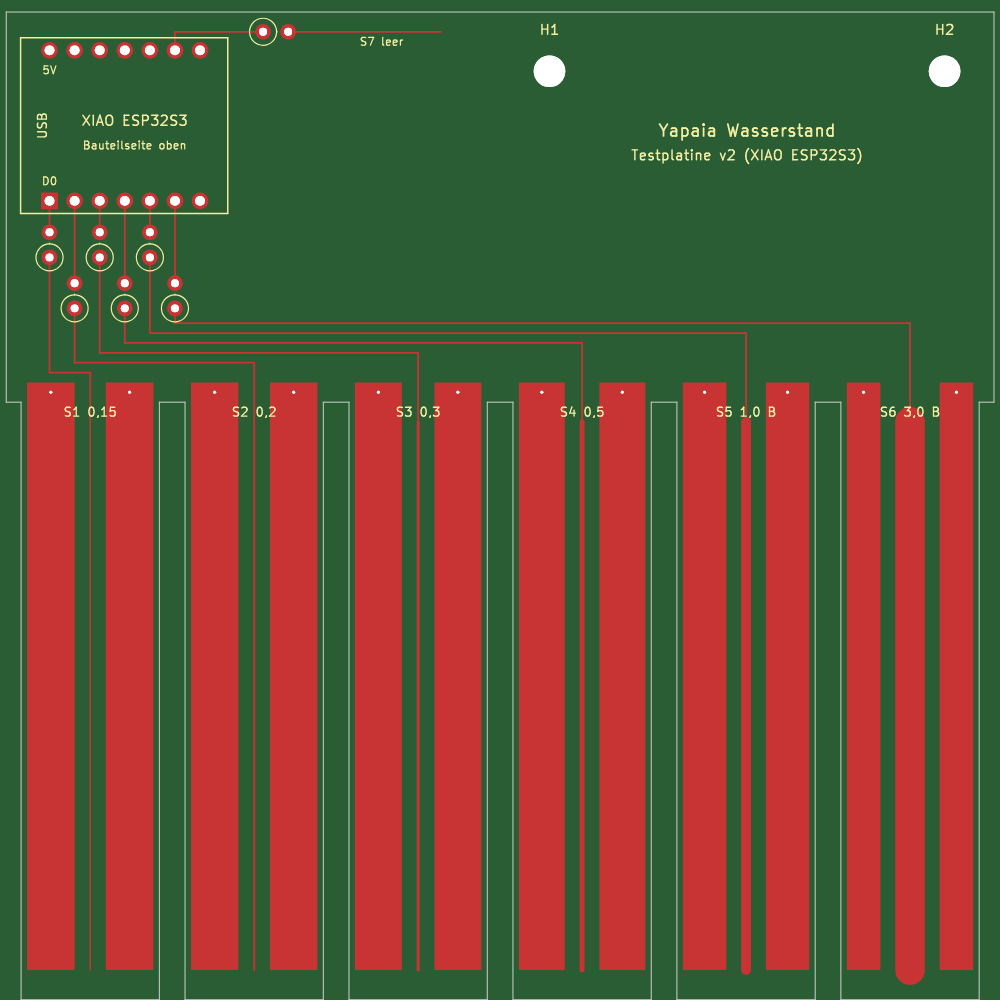

# Testplatine v2 – Bahnbreiten ausmessen

Kleine Platine (100 × 100 mm, 2 Lagen, 1,6 mm FR4), um vor der 50-cm-Sonde
zu messen, welche Bahnbreite und welche Isolierung am ESP32-S3 am besten
funktionieren. Sechs Finger mit je einer Messbahn, dazu ein Leerkanal. Der
ESP (**Seeed XIAO ESP32S3**) sitzt direkt auf der Platine, alle Kanäle werden
gleichzeitig gemessen.

| Vorderseite | Rückseite |
|---|---|
|  |  |

## Warum der XIAO ESP32S3

- Belegung ist eindeutig dokumentiert (keine wechselnden Klone wie beim
  „S3 SuperMini“): D0–D5 = GPIO1–6, D8–D10 = GPIO7–9 – das sind alles
  Touch-Eingänge (T1–T9 laut `arduino-esp32/variants/XIAO_ESP32S3/pins_arduino.h`).
- Klein (21 × 17,8 mm), zwei Reihen à 7 Pins im 2,54-mm-Raster, Reihenabstand
  15,24 mm (aus Seeeds KiCad-Bibliothek).
- USB-C, 3,3-V-Regler, in ESPHome als `seeed_xiao_esp32s3`.
- Antenne extern (U.FL) – die mitgelieferte Antenne anstecken.

## Aufbau

- **Kopf** (oben, 39,5 mm, bleibt trocken): XIAO ESP32S3 (U1, Bauteilseite
  oben, USB-C zeigt nach links über die Platinenkante), Serienwiderstände
  R1–R7 (510 Ω, **bedrahtet**, stehend im 2,54-mm-Raster, versetzt in zwei
  Reihen) direkt an den Pins, zwei M3-Löcher zum Aufhängen.
  Rückseite: GND als Gitter (wie von Espressif empfohlen).
- **Finger** (60 mm lang, 14 mm breit): mittig die Messbahn, links und rechts
  GND-Streifen (Vorder- und Rückseite, 1,5 mm Abstand zur Messbahn). Unter der
  Messbahn ist kein Kupfer. Alles unter Lötstopplack, im nassen Bereich keine
  Durchkontaktierungen, Kupfer endet 3 mm vor der Unterkante.
- **Skala** auf der Rückseite: Striche alle 1 cm, 0 = unteres Ende der Messbahn
  (Messbahn reicht bis 5,5 cm).

| Kanal | XIAO-Pin | GPIO | Bahnbreite | Isolierung | erwartet bei 5,5 cm (Lack 10 / 20 / 30 µm) |
|---|---|---|---|---|---|
| S1 | D0 | 1 | 0,15 mm | Lack | 28 / 14 / 9 pF |
| S2 | D1 | 2 | 0,2 mm | Lack | 37 / 18 / 12 pF |
| S3 | D2 | 3 | 0,3 mm | Lack | 55 / 27 / 18 pF |
| S4 | D3 | 4 | 0,5 mm | Lack | 90 / 45 / 30 pF |
| S5 | D4 | 5 | 1,0 mm | Lack, danach Schrumpfschlauch | 174 / 87 / 58 pF (mit Schlauch ≈ 3,5 pF) |
| S6 | D5 | 6 | 3,0 mm | Lack, danach Schrumpfschlauch | 459 / 230 / 153 pF (mit Schlauch ≈ 9 pF) |
| S7 | D8 | 7 | – (endet im Kopf) | – | nur Grundkapazität, Bezug für Drift |
| GND | GND | | | | |

Frei bleiben D6/D7 (UART) und D9/D10 (GPIO8/9, auch Touch – Reserve).
Werte aus `../../rechner.py`. Bei S6 sind die GND-Streifen nur 4,5× so breit
wie die Messbahn; das kostet dort ca. 18 % Signal (ist eingerechnet).

## Bestellen

Fertigungsdaten: [`fertigung/testplatine-gerber.zip`](fertigung/testplatine-gerber.zip)
(Gerber + Bohrdaten, ohne X2-Erweiterungen, wie JLCPCB es empfiehlt). Die ZIP
**unverändert** hochladen – nicht entpacken. Mit einem unabhängigen Gerber-Viewer
(gerbv) geprüft: Umriss, Schlitze, Bohrungen und Lagen stimmen.

Einstellungen bei JLCPCB (sonst Standard lassen):

| Option | Wert |
|---|---|
| Base Material | FR-4 |
| Layers | 2 |
| Dimension | 100 × 100 mm (wird erkannt) |
| PCB Qty | 5 (Minimum) |
| PCB Thickness | 1.6 mm |
| PCB Color | Green (für den Vergleich mit der späteren Sonde dieselbe Farbe nehmen – andere Farben haben andere Lackdicken) |
| Silkscreen | White |
| Surface Finish | HASL (lead free) |
| Outer Copper Weight | 1 oz |
| Via Covering | Tented |
| Mark on PCB / Remove Order Number | egal; die Nummer stört nicht |
| PCB Assembly | **nein** (wir löten selbst) |

Die Schlitze zwischen den Fingern sind im Umriss enthalten, dafür ist keine
Zusatzoption nötig. Kleinste Werte: Bahn 0,15 mm, Abstand 0,3 mm, Bohrung
0,3 mm – alles im Standard von JLCPCB.

Neu erzeugen (KiCad 7): `./fertigung.sh` – baut `testplatine.kicad_pcb` aus
`erzeuge.py` und exportiert Gerber, Bohrdaten und Vorschau. Die Maße stehen
oben in `erzeuge.py` und lassen sich dort ändern. Der DRC meldet nur die
offenen Enden der Messbahnen (gewollt: Elektroden).

## Bestücken und Anschließen

1. R1–R7: 510 Ω, bedrahtet (z. B. Metallschicht 0,25 W, Bauform 0207).
   **Stehend** einbauen: Körper auf das Pad mit dem Kreis im Bestückungsdruck,
   den anderen Draht oben umbiegen und ins Nachbarloch. Keine SMD-Teile.
2. XIAO ESP32S3 mit zwei 7-poligen Stiftleisten einlöten (oder Buchsenleisten,
   dann ist er wiederverwendbar). Bauteilseite nach oben, USB-C nach links –
   Pin D0 ist das eckige Pad, so steht es auch im Bestückungsdruck.
3. Antenne anstecken, Strom über USB-C.
4. ESPHome: [`testplatine.yaml`](testplatine.yaml) – meldet die Rohwerte aller
   sieben Kanäle an Home Assistant und loggt sie (`setup_mode`).
   Braucht `waterlevel_*`-Einträge in der `secrets.yaml`.

## Messablauf

1. **Trocken**: Rohwerte S1–S7 notieren (Grundwert).
2. In ein Gefäß mit **Leitungswasser** (z. B. hoher Messbecher, ≥ 11 cm breit)
   bis höchstens zur 5-cm-Marke (Kopf bleibt trocken!) in Schritten von 1 cm eintauchen, je 30 s warten, Rohwerte notieren
   (in HA als Verlauf). Erwartung: linear mit der Tiefe.
3. Rauschen bei fester Tiefe über 1 min ansehen (Signal/Rauschen > 5:1 je cm?).
4. Herausziehen: wie schnell geht der Wert auf den Grundwert zurück (Wasserfilm)?
5. **Drift**: 24 h in 4 cm Tiefe stehen lassen, S7 als Vergleich.
6. **Variante B**: S5/S6 mit Schrumpfschlauch (Kleber-frei, ohne
   Lufteinschlüsse) überziehen und Schritte 1–4 wiederholen.
7. Optional: Wasser mit etwas Salz / destilliertes Wasser – Einfluss der
   Leitfähigkeit.

Auswerten: Rohwert je cm und Rauschen je Kanal → Bahnbreite für die Sonde
festlegen, `rechner.py` mit der gemessenen Kapazität je mm abgleichen.
