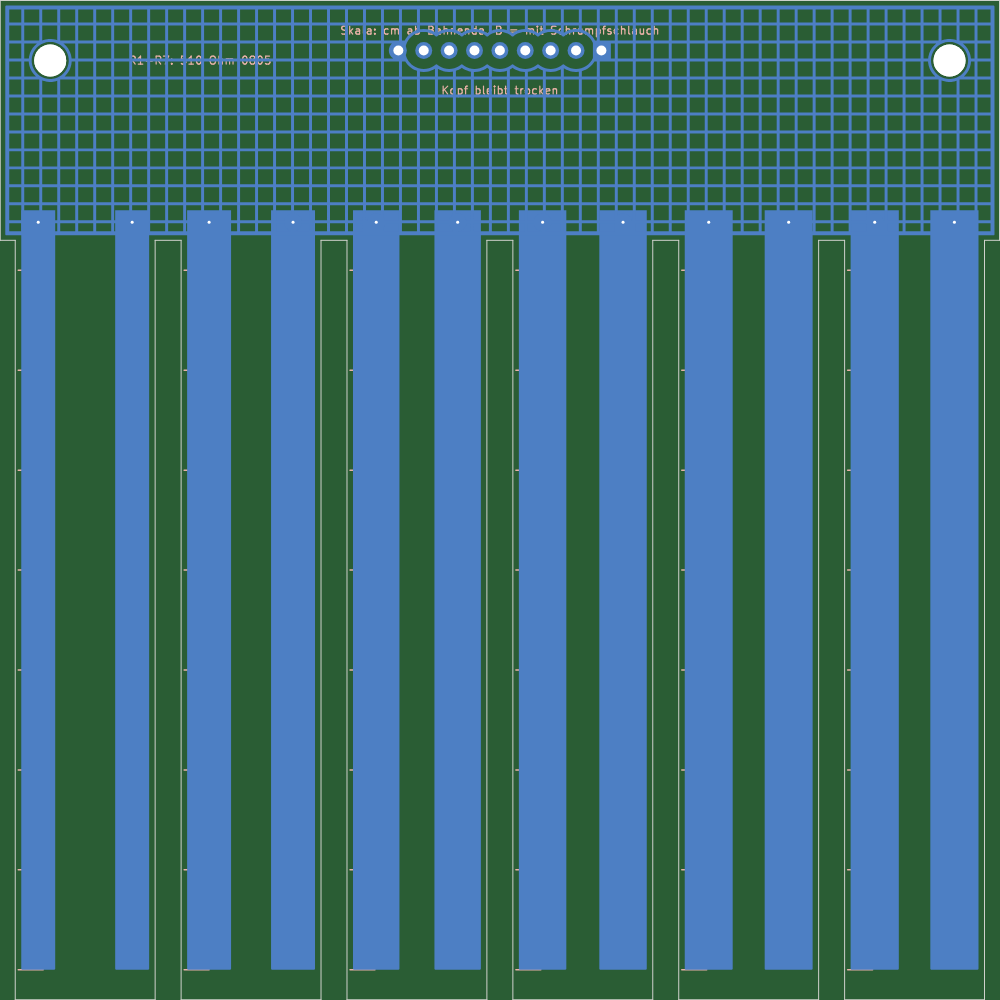

# Testplatine v1 – Bahnbreiten ausmessen

Kleine Platine (100 × 100 mm, 2 Lagen, 1,6 mm FR4), um vor der 50-cm-Sonde
zu messen, welche Bahnbreite und welche Isolierung am ESP32-S3 am besten
funktionieren. Sechs Finger mit je einer Messbahn, dazu ein Leerkanal.

| Vorderseite | Rückseite |
|---|---|
|  |  |

## Aufbau

- **Kopf** (oben, 24 mm, bleibt trocken): Stiftleiste J1 (1×9, 2,54 mm),
  Serienwiderstände R1–R7 (0805, 510 Ω), zwei M3-Löcher zum Aufhängen.
  Rückseite: GND als Gitter (wie von Espressif empfohlen).
- **Finger** (76 mm lang, 14 mm breit): mittig die Messbahn, links und rechts
  GND-Streifen (Vorder- und Rückseite, 1,5 mm Abstand zur Messbahn). Unter der
  Messbahn ist kein Kupfer. Alles unter Lötstopplack, im nassen Bereich keine
  Durchkontaktierungen, Kupfer endet 3 mm vor der Unterkante.
- **Skala** auf der Rückseite: Striche alle 1 cm, 0 = unteres Ende der Messbahn
  (Messbahn reicht bis 7,1 cm).

| Kanal | J1-Pin | ESP32-S3 | Bahnbreite | Isolierung | erwartet bei 7,1 cm (Lack 10 / 20 / 30 µm) |
|---|---|---|---|---|---|
| S1 | 2 | GPIO1 | 0,15 mm | Lack | 35 / 18 / 12 pF |
| S2 | 3 | GPIO2 | 0,2 mm | Lack | 47 / 24 / 16 pF |
| S3 | 4 | GPIO3 | 0,3 mm | Lack | 70 / 35 / 23 pF |
| S4 | 5 | GPIO4 | 0,5 mm | Lack | 115 / 58 / 38 pF |
| S5 | 6 | GPIO5 | 1,0 mm | Lack, danach Schrumpfschlauch | 223 / 111 / 74 pF (mit Schlauch ≈ 5 pF) |
| S6 | 7 | GPIO6 | 3,0 mm | Lack, danach Schrumpfschlauch | 587 / 294 / 196 pF (mit Schlauch ≈ 12 pF) |
| S7 | 8 | GPIO7 | – (endet im Kopf) | – | nur Grundkapazität, Bezug für Drift |
| GND | 1, 9 | GND | | | |

Werte aus `../../rechner.py`. Bei S6 sind die GND-Streifen nur 4,5× so breit
wie die Messbahn; das kostet dort ca. 18 % Signal (ist eingerechnet).

## Bestellen

Fertigungsdaten: [`fertigung/testplatine-gerber.zip`](fertigung/testplatine-gerber.zip)
(Gerber + Bohrdaten), so z. B. bei JLCPCB hochladen:

- 2 Lagen, 1,6 mm, 100 × 100 mm, 1 oz Kupfer
- Lötstopplack: grün (Standard; andere Farben haben andere Lackdicken – für
  den Vergleich mit der späteren Sonde dieselbe Farbe nehmen)
- Oberfläche: HASL bleifrei oder ENIG
- Die Schlitze zwischen den Fingern sind im Umriss (Edge.Cuts) enthalten.

Neu erzeugen (KiCad 7): `./fertigung.sh` – baut `testplatine.kicad_pcb` aus
`erzeuge.py` und exportiert Gerber, Bohrdaten und Vorschau. Die Maße stehen
oben in `erzeuge.py` und lassen sich dort ändern. Der DRC meldet nur die
offenen Enden der Messbahnen (gewollt: Elektroden).

## Bestücken und Anschließen

1. R1–R7: 510 Ω (0805), J1: Stiftleiste.
2. ESP32-S3-Board mit **kurzen, gleich langen** Leitungen (≤ 10 cm) an J1;
   Kabel gehen in die Grundkapazität ein. Besser: Board direkt neben J1
   festschrauben.
3. ESPHome: [`testplatine.yaml`](testplatine.yaml) – meldet die Rohwerte aller
   sieben Kanäle an Home Assistant und loggt sie (`setup_mode`).
   Braucht `waterlevel_*`-Einträge in der `secrets.yaml`.

## Messablauf

1. **Trocken**: Rohwerte S1–S7 notieren (Grundwert).
2. In ein Gefäß mit **Leitungswasser** (z. B. hoher Messbecher, ≥ 11 cm breit)
   in Schritten von 1 cm eintauchen, je 30 s warten, Rohwerte notieren
   (in HA als Verlauf). Erwartung: linear mit der Tiefe.
3. Rauschen bei fester Tiefe über 1 min ansehen (Signal/Rauschen > 5:1 je cm?).
4. Herausziehen: wie schnell geht der Wert auf den Grundwert zurück (Wasserfilm)?
5. **Drift**: 24 h in 5 cm Tiefe stehen lassen, S7 als Vergleich.
6. **Variante B**: S5/S6 mit Schrumpfschlauch (Kleber-frei, ohne
   Lufteinschlüsse) überziehen und Schritte 1–4 wiederholen.
7. Optional: Wasser mit etwas Salz / destilliertes Wasser – Einfluss der
   Leitfähigkeit.

Auswerten: Rohwert je cm und Rauschen je Kanal → Bahnbreite für die Sonde
festlegen, `rechner.py` mit der gemessenen Kapazität je mm abgleichen.
