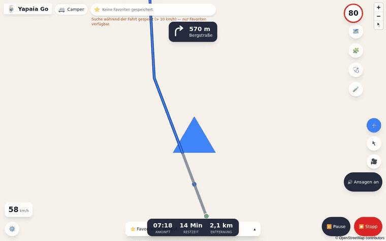
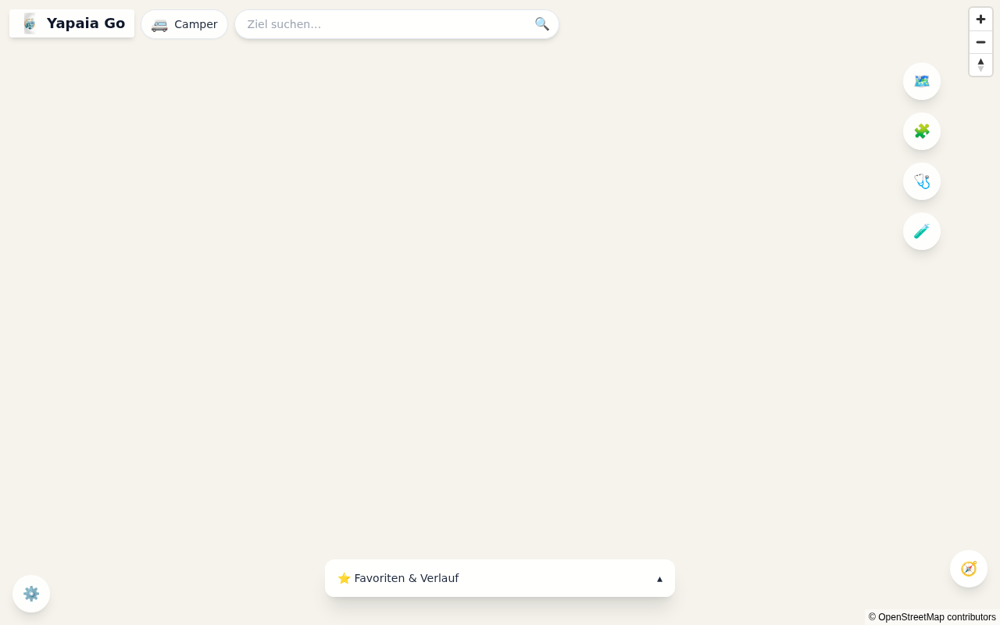
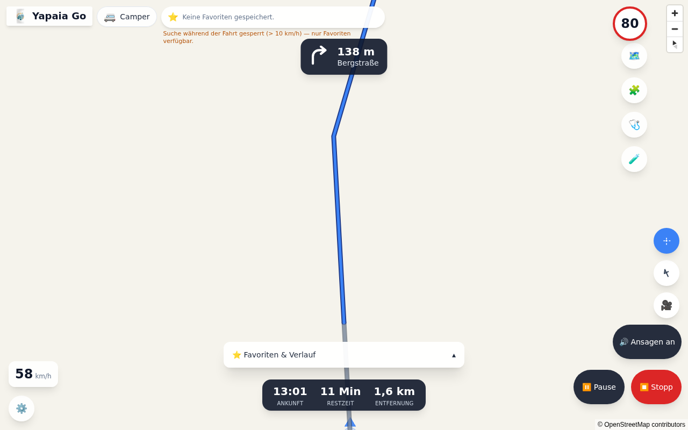
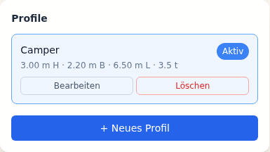
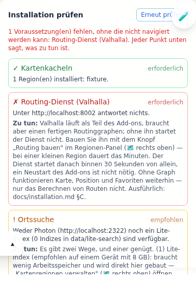

# Yapaia Go

**Offline navigation for motorhomes, running on your own hardware.**

Yapaia Go routes your motorhome around the bridge that is too low and the road
that is too narrow — with **no internet connection, no account, and no data
leaving your vehicle**. Maps, routing and search all run on a mini-PC in your
camper. It installs as a **Home Assistant add-on** and opens in any browser:
the tablet on your dashboard, your phone, the co-driver's iPad.

A real recording of the running app. The map background is blank because
this was captured against the automated test harness, which carries a map
fixture with no tiles behind it — everything Yapaia draws itself (route,
position, controls) is real. [Why, in detail.](docs/media/README.md)

---

## Why this exists

Phone navigation stops at the mountain pass where the mobile signal does. Truck
navigation devices know your height and weight but cost hundreds and age badly.
Yapaia Go is the third option: the routing engine that professional logistics
uses (**Valhalla**), fed with your vehicle's real dimensions, running on
hardware you already own.

**It genuinely works offline.** Not "works offline once cached" — navigation
never depends on a connection. Map tiles, the routing graph and the address
index all live on your disk. A few online extras exist, but they are off by
default and nothing breaks without them. The end-to-end test suite asserts
that the app makes **zero foreign network requests** while navigating.

## What it does

| | |
|---|---|
| 🚐 **Routes for your actual vehicle** | Height, width, length and weight go into every route. A 3.20 m camper is not sent under a 3.00 m bridge. |
| 📴 **Fully offline** | Vector maps (PMTiles), routing (Valhalla) and address search (Photon) run locally. No SIM card, no roaming, no account. |
| 🗺️ **Turn-by-turn navigation** | Spoken instructions, automatic rerouting, ETA, speed limits, and a speed warning when you exceed one. |
| 📍 **Any position source** | Your browser's GPS, a USB GPS receiver, or the **Home Assistant Companion App** on your phone — which keeps reporting with the screen locked. |
| 🏠 **Deep Home Assistant integration** | Position, ETA, remaining distance and the next instruction become HA entities. Automate on them: *"ETA under 30 minutes → switch on the boiler."* |
| 🔆 **Screen stays awake** | No more tapping the tablet at every junction to keep the display on. |
| 👋 **Built for a moving vehicle** | 64 px touch targets, mirrored controls for left- or right-hand drive, and settings that lock themselves above 10 km/h. |
| 🧩 **Extensible** | A sandboxed add-on system with its own SDK and a marketplace of signed add-ons. |

| | |
|:--:|:--:|
|  |  |
| **Explore** — search, favourites, your vehicle at a glance | **Drive** — manoeuvre, speed limit, ETA, remaining distance |
|  |  |
| **Your vehicle** — height, width, length, weight | **The health check** — says what is wrong and what to do |

## What it is not

Being straight about this saves you an evening:

- **It is not a phone app.** It runs on a mini-PC in your vehicle and is used
  through a browser. There is no App Store download.
- **It does not have live traffic.** That is the price of working offline.
  Roadworks from last week are not in your map — unless you switch on the
  optional online services (off by default), which add roadworks and closures
  on German motorways while a connection exists.
- **Map data is only as complete as OpenStreetMap.** Height and weight limits
  are well mapped on main roads and patchy on small ones. Yapaia warns you
  about this when your profile is over 2.70 m — it is a real limit of the data,
  not a software bug, and no offline navigation can fully solve it.
- **It needs a real computer.** Roughly 6 GB of RAM for a country-sized map
  region with search enabled. See [Requirements](#requirements).

---

## Installing

**As a Home Assistant add-on** (the recommended path — no terminal needed):

1. In Home Assistant, go to **Settings → Add-ons → Add-on Store → ⋮ → Repositories**.
2. Add `https://github.com/Yapaia/yapaia`.
3. Install **Yapaia Go** from the store, then start it.
4. Open it from the Home Assistant sidebar. A setup wizard walks you through
   language and units, the notes on use, your map region, your vehicle's
   dimensions and where the position comes from.
5. Restart Home Assistant once when the notification asks you to, then
   confirm **"Yapaia Go discovered"** under *Settings → Devices & Services*.

Home Assistant downloads a ready-made image for your machine; nothing is
built on your device. The full walkthrough — every decision the wizard asks
you to make, and what happens if you get it wrong — is in the [**User Manual**](docs/manual.md).

**Standalone with Docker Compose** (without Home Assistant), or on a Proxmox
LXC: see the [Installation Guide](docs/installation.md).

## Requirements

Yapaia Go shares the RAM of whatever machine it runs on — including, on a Home
Assistant OS VM, with Home Assistant itself and every other add-on.

| Component | RAM, country-sized map region |
|---|---|
| Core (Node/Fastify) | ≤ 300 MB |
| Valhalla (routing) | ≤ 1.5 GB |
| Photon (address search, default heap) | ~600 MB – 1 GB |
| **Yapaia total** | **~2.4 – 2.9 GB** |

Add Home Assistant, the Supervisor and your other add-ons — commonly another
1–1.5 GB — and a HAOS VM wants **6 GB or more** for a country-sized region with
search enabled. A single state or a small country needs noticeably less, since
both Valhalla's and Photon's footprint scale with the size of the region.

Disk: budget roughly 10 GB for one region, more if you install several.
CPU: x86-64 or ARM64; an N100-class mini-PC is the reference machine.

Measured on the reference machine (N100, Germany + Switzerland + Liechtenstein,
2026-10): with Photon **off** (lite search) the whole add-on uses about
**330 MB** (Valhalla ~300 MB resident, Core ~110 MB). Building the map data on
the device needs far more than running it — see the installation guide.

Tight on RAM? Turning off the `photon_enabled` option drops the single biggest
consumer and falls back to a built-in lightweight search index — you keep place
and street names, you lose house numbers. The
[Manual](docs/manual.md#if-you-are-short-on-memory) explains the trade-off.

---

## Licence

Yapaia Go is free software under the **GNU General Public License v3.0 or
later** (see [`LICENSE`](../LICENSE) at the repository root). It comes
**without any warranty**; liability is excluded to the extent permitted by law
(GPL-3.0, sections 15 and 16). All guidance it shows — routes, clearance
heights, speed limits, lanes — is advisory; the driver remains responsible.

**Exception:** the add-on SDK (`packages/addon-sdk`) and the example add-ons
(`addons-examples/poi-campsites`, `addons-examples/track-recorder`) are under the
**Apache License 2.0**, so add-ons built on them can use any licence, including
proprietary ones.

Third-party components and data (OpenStreetMap/ODbL, Valhalla, MapLibre …):
[`DRITTLIZENZEN.md`](../DRITTLIZENZEN.md). The name and logo are not covered by
the licence: [`NAME-UND-LOGO.md`](../NAME-UND-LOGO.md).

> **Contributing code:** please open an issue first. Contributions are only
> accepted together with a contributor agreement that lets the project keep
> offering Yapaia under other terms as well (e.g. to manufacturers).

## Documentation

| For | Document |
|---|---|
| 🧭 **Using the app** | [**User Manual**](docs/manual.md) — every feature, in plain language, including [installing add-ons](docs/manual.md#add-ons) |
| 🔧 **Installing it** | [Installation Guide](docs/installation.md) (German) · [First Steps](docs/erste-schritte.md) (German) · [Own maps, routing and search](docs/eigene-karten.md) (German) |
| ❓ **Something is wrong** | [Troubleshooting](docs/troubleshooting.md) (German) · [FAQ](docs/faq.md) (German) |
| 💻 **Contributing code** | [**Developer Guide**](docs/developers.md) — architecture, interfaces, CI/CD |
| 🧩 **Writing an add-on** | [Add-on Development Guide](docs/addon-dev-guide.md) (German) · [`@yapaia/addon-sdk`](packages/addon-sdk) |
| 🏠 **Home Assistant details** | [HA Integration](docs/04-home-assistant.md) (German) |
| 📋 **What changed** | [Add-on Changelog](yapaia_go/CHANGELOG.md) (German, shown in HA before an update) |

Design records from the planning phase live in `docs/00-` … `docs/08-` and in
`tasks/`. They document *why* decisions were made and are kept for that reason;
where they describe a future that has since arrived, the current behaviour is
what the Developer Guide and the Manual say.

## Technology

TypeScript throughout. **Frontend:** React 18, Vite, MapLibre GL JS 6, Zustand,
Tailwind. **Backend:** Node 24, Fastify 5, SQLite. **Maps:** OpenStreetMap as
PMTiles. **Routing:** Valhalla. **Search:** Photon, with an offline fallback
index. **Packaging:** a single container, s6-overlay supervised, served through
Home Assistant Ingress.

Architecture, module boundaries and the reasoning behind these choices:
[Developer Guide](docs/developers.md).

## Project status

Yapaia Go is at **0.56.0** and in active use. The CI pipeline runs unit
tests, browser tests, a sandbox-escape security suite, performance budgets, a
dependency and licence gate, and a routing safety gate on every pull request
— all of them blocking. What is still open is tracked in
[`docs/backlog.md`](docs/backlog.md).

## Contributing

Issues are welcome; for code, please open an issue first (see the note on
the contributor agreement under [Licence](#licence)). Start with the
[Developer Guide](docs/developers.md) — it covers the repository layout, how to
run the test suites, and the pitfalls that have cost time before.

## Naming

The product is **Yapaia Go**. Technical identifiers use `yapaia_go` — the
add-on slug and the Home Assistant entity IDs such as `sensor.yapaia_go_tempo`
— and the npm scope is `@yapaia`.
